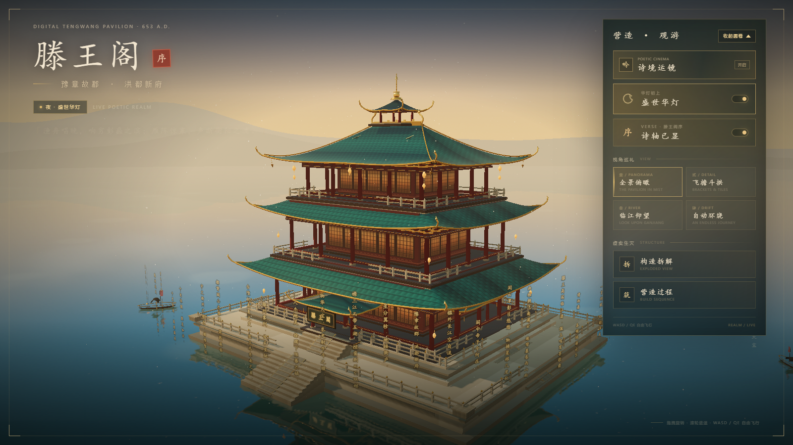
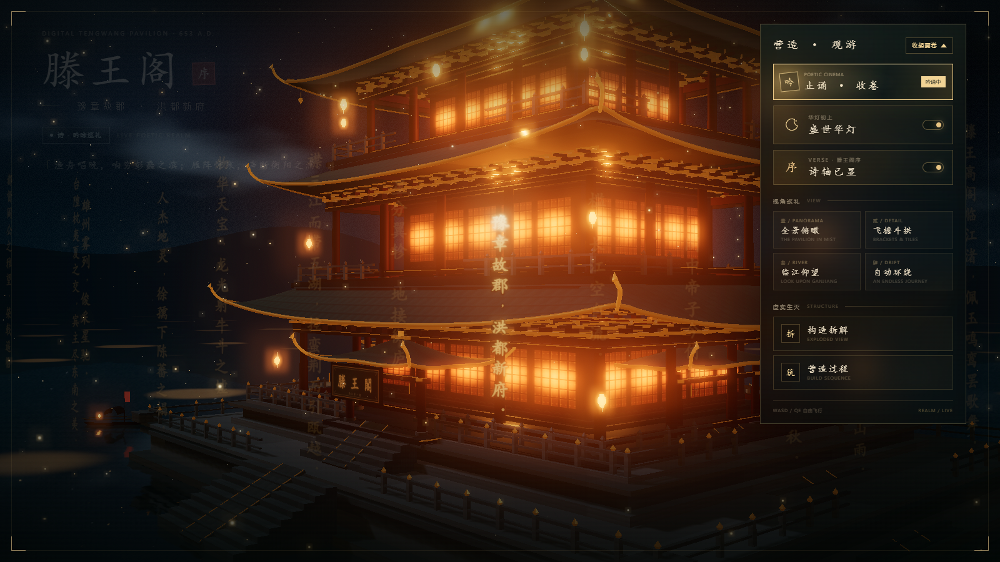

# 滕王阁 · 数字长卷

一座用代码重建的滕王阁，与一整卷悬在楼阁四周的《滕王阁序》。

全文 936 字（序 + 附诗）被切成 **76 列竖排诗轴**，一句一列、列内不换行，按设计好的天际线高低错落挂在檐口之外；朗诵原声（4 分 10 秒，未裁剪）就是唯一的时间轴——镜头随朗读逐字连续移动，读到哪里、哪里亮起。




## 特性

- **单文件页面**：`index.html` 内含全部样式、着色器与场景数据（Three.js r160 + GSAP，走 unpkg / jsDelivr）。
- **逐字同步**：以朗诵音频的逐字时间戳驱动诗轴浸染与运镜，音画漂移约 0.03 s。
- **完整原文**：一句一列，长句不拆列（如「物华天宝，龙光射牛斗之墟；」整句一列）。
- **昼夜双态**、构造拆解、营造过程、视角巡礼，另有诗词总开关。
- **移动端适配**：面板自动收起，折叠态只在小方块里留一个折叠图标。
- **离线兜底**：`assets/` 缺失时页面回退到内嵌 base64 音频，照样能播。

## 目录

```
index.html                    页面（含离线音频兜底）
assets/narration.m4a          朗诵原声，250.29 s
assets/narration-timing.json  936 字的逐字时间戳
assets/asr-words.json         faster-whisper 词级缓存（重跑对齐用）
assets/tengwang-order.txt     校对的原文
tools/asr_full.py             音频转写 → assets/asr-words.json
tools/align_full.py           拼音对齐 → assets/narration-timing.json
tools/sync_text.py            把时间轴 / 音频注入页面
tools/extract_check.py        module 脚本语法自检
docs/                         预览图
```

## 本地预览

```bash
python -m http.server 8000
```

然后打开 <http://127.0.0.1:8000/>。
页面从 CDN 取 three / gsap，需要联网；静态托管环境同样可用。

## 换音频或改文案后重新对齐

```bash
python tools/asr_full.py       # 需要 faster-whisper + ffmpeg，只跑一次
python tools/align_full.py     # 读缓存，秒级
python tools/sync_text.py      # 注入页面（时间轴 + base64 兜底 + 音频路径）
python tools/extract_check.py  # 语法自检
```

## 部署

纯静态，任意静态托管均可。线上版本部署在 GitHub Pages：源码仓私有，发布用的 `-pages` 仓公开，只推送 `index.html` 与 `assets/`。

## 备注

- 诗轴列高随句长变化（5.2 ~ 13.4 世界单位），整圈靠一条十六拍的天际线节奏错落；
- 卷首列方位角取自「全景俯瞰」机位，第一句正对楼阁正面，整组只做小幅摆动、不再无限自转；
- 背景音乐（琴韵）已停用：页面里 `BGM_ENABLED = false`，音频合成代码保留，恢复方法见文件内注释。
